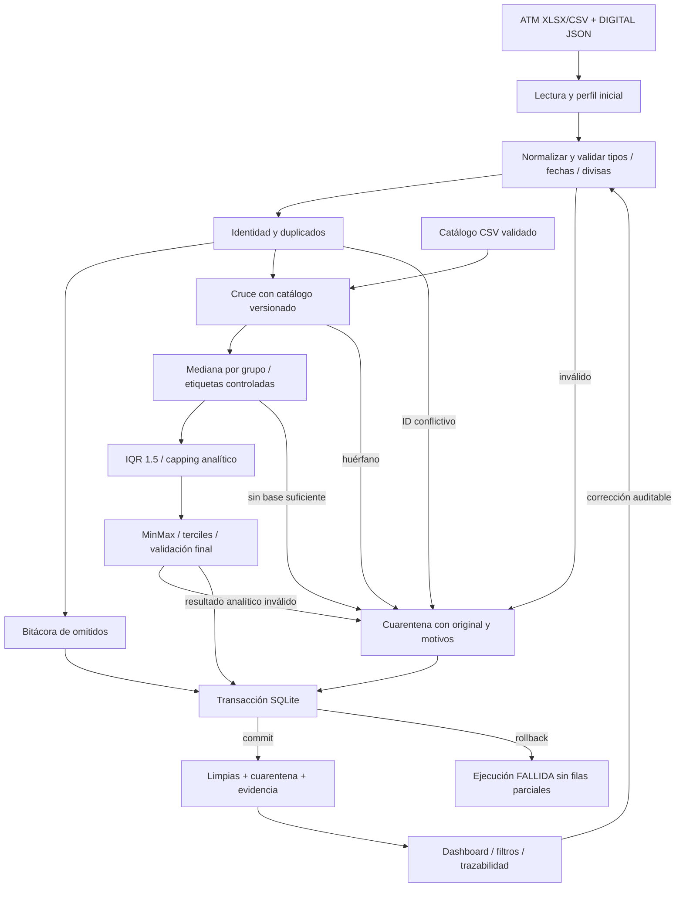

# Flujo del pipeline

La validación temprana evita usar montos corruptos para ajustar estadísticas. La cuarentena conserva las filas rechazadas; el capping conserva el importe de origen y solo cambia el importe analítico. Los reprocesamientos generan nueva ejecución, sin borrar el rechazo original.